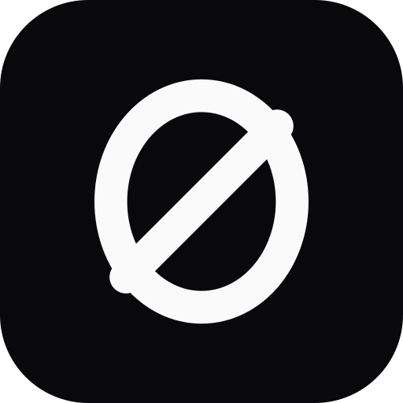
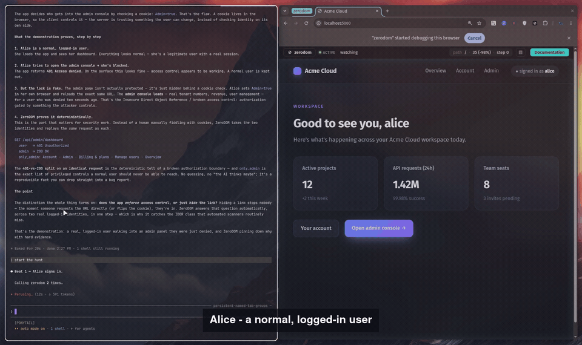

<div align="center">



# ZeroDOM

### Point it at an app as two users. It finds the broken access control.

ZeroDOM drives your **real, logged-in browser** as two identities, replays the same
requests as each, and flags where one user reaches what another can't —
**IDOR / broken access control**, caught deterministically.
Open-core, runs local, no account, no API key, nothing leaves your machine.

<sub>Under the hunt is a deterministic, token-lean perception engine for AI agents — the same core powers <code>scan</code>, <code>crawl</code> and any browser-driving task. IDOR is just where it bites hardest.</sub>

[](https://pypi.org/project/zerodom/)
[](https://www.npmjs.com/package/@vexralabs/zerodom)
[](LICENSE)
[](https://github.com/DevHusnainAi/zerodom/actions/workflows/ci.yml)
[](#use-it-from-an-ai-agent-mcp)
[](https://discord.gg/tVRznUb5Ez)

**[Site](https://zerodom.vexralabs.com)** · **[Docs](https://zerodom.vexralabs.com/docs)** · **[Playground](https://zerodom.vexralabs.com/playground)** · **[Discord](https://discord.gg/tVRznUb5Ez)** · **[Quickstart ↓](#quickstart)**

<br/>



<sub>A normal user is <b>denied</b> the admin console (401) — then walks in by flipping one client-controlled cookie. ZeroDOM proves it: same request, two identities, <b>401 vs 200</b>. <a href="assets/idor-demo.mp4">Full recording (mp4)</a>.</sub>

</div>

---

## Contents

- [Why ZeroDOM](#why-zerodom)
- [Quickstart](#quickstart)
- [How it hunts — `compare` & `sweep`](#how-it-hunts--compare--sweep)
- [Use it from an AI agent (MCP)](#use-it-from-an-ai-agent-mcp)
- [Why the agent sees so few tokens](#why-the-agent-sees-so-few-tokens)
- [More of the CLI](#more-of-the-cli)
- [How it compares](#how-it-compares)
- [Install](#install)
- [Security & scope](#security--scope)
- [Limitations](#limitations)
- [Editions](#editions)
- [Contributing & development](#contributing--development)
- [License](#license)

---

## Why ZeroDOM

**Two audiences, one engine:**

- **AppSec — [`compare` / `sweep`](#how-it-hunts--compare--sweep):** deterministic two-identity
  authorization testing that runs **headless in CI or your recon pipeline** — no GUI, no account.
- **AI agents — [MCP](#use-it-from-an-ai-agent-mcp):** a flat interaction graph that cuts
  **~71% of the tokens** vs Playwright's `aria_snapshot`, with handles that resolve 1:1 and don't
  drift when the page re-renders.

**Broken access control is the #1 web vulnerability** (OWASP A01) and the one automated
scanners miss — because catching it means knowing *who should be allowed to do what*, not
just fuzzing one session. The usual answer is a human in Burp, clicking through the app as
one user, then again as another, diffing by eye.

ZeroDOM does that mechanically. Give it two logged-in sessions; it replays the same request
as each and reports the deterministic tells:

- **`access-boundary-split`** — one identity gets `200`, the other `401/403` on an identical
  request. If the only difference between them is client-controllable (a cookie, header or
  param), that's broken access control.
- **`cross-identity-identical-response`** — two users get a **byte-identical** body on a
  per-user resource: a cross-tenant IDOR.

No LLM guessing, no "the AI thinks maybe." ZeroDOM surfaces the tell with the exact replay
that proves it — a reviewable diff you drop straight into a bug report. **You confirm the bug.**

It drives your **real Chrome** (relay mode) over `chrome.debugger`, so your cookies, MFA and
SSO are already done — or a throwaway browser (`--stealth`) if you'd rather not touch your
session. Either way the page's markup never leaves your machine, and it's **read-only by
default**: destructive actions and out-of-scope hosts are refused.

> It works equally well as a one-line CLI, a recon pipeline stage, or a native tool an
> **AI agent** drives through MCP. Same deterministic primitives, three front doors.

---

## Quickstart

**See it run in 10 seconds** — no account, no browser download (bare `zerodom <url>` is a static
fetch, no Chromium needed):

```bash
pip install zerodom                      # or: uvx zerodom · npm i @vexralabs/zerodom
zerodom https://news.ycombinator.com     # the interaction graph + a token report
```

That's the perception engine — a flat, 1:1-addressable graph instead of 12k tokens of HTML.

**Now the flagship — find an IDOR.** Save two logged-in sessions as Playwright `storage_state`
files (one per account), then diff a protected endpoint across both:

```bash
zerodom compare https://app.example.com/api/admin/dashboard \
  --as user=user.json --as admin=admin.json
```

```jsonc
{
  "identities": {
    "user":  { "status": 401, "bytes": 2616 },
    "admin": { "status": 200, "bytes": 3469 }
  },
  "only_admin": ["Manage users", "Billing & plans", "Overview"],
  "note": "admin authorized (200) where user denied (401) — broken access control if the
           only difference is client-controllable"
}
```

That's the whole loop: same request, two identities, a 401-vs-200 split → a lead to confirm.
`only_admin` lists the privileged controls the normal user should never see.

**Don't have storage-state files?** Capture one with
`context.storage_state(path="user.json")` in Playwright, or export cookies from a logged-in
session. **Want the whole app, not one URL?** → [`zerodom sweep`](#how-it-hunts--compare--sweep).

---

## How it hunts — `compare` & `sweep`

### `zerodom compare` — one endpoint, across identities

Fetch one URL under each saved session and diff the responses. Byte-identical content across
two users on a private resource is a cross-tenant IDOR; a 401-vs-200 split is a broken
boundary. `only_<name>` lists the actionable nodes each identity sees that the other doesn't.

```bash
# Sweep a range of object ids through two identities:
seq 1 500 | sed 's#^#https://app.example.com/api/invoice/#' \
  | zerodom compare - --as alice=alice.json --as bob=bob.json \
  | jq 'select(.identical_body_pairs | length > 0)'
```

### `zerodom sweep` — the whole app, one command

`compare` tests one URL. **`sweep` does the entire app:** it crawls as one identity to map the
GET surface (pages + the API calls the JS fires), then replays every in-scope URL under *all*
your identities and reports only the deterministic tells.

```bash
zerodom sweep https://app.example.com --as user=user.json --as admin=admin.json --format md
```

```text
| severity | rule                   | url                                   |
| -------- | ---------------------- | ------------------------------------- |
| medium   | access-boundary-split  | https://app.example.com/api/admin/... |
```

Read-only throughout: only GET is replayed, destructive URLs are dropped (`--deny`).
`--format md` emits a report-ready table (default is JSONL). This is the "point it at an app
with two logins and it finds the broken access control" pass.

Both take `--proxy` (route through Burp/Caido), `--header` (a program's WAF-bypass token), and
a scope you can lock. Challenge pages (Cloudflare / Turnstile / reCAPTCHA / hCaptcha) are
detected and climbed by a scope-gated clearance ladder; a wall nothing clears is reported as
an honest `blocked`, never worked around outside an authorized target.

---

## Use it from an AI agent (MCP)

Standard MCP browser tools hand the model raw pixels (slow, stale on scroll) or an accessibility
tree (no stable handles — repeated controls collide). `zerodom-mcp` gives your agent a **flat,
token-frugal graph** where every `click [45]` resolves deterministically over CDP to exactly one
element — and the same tools do cross-identity IDOR hunting the others can't. [Why ↓](#why-the-agent-sees-so-few-tokens)

ZeroDOM is a native **MCP server**, so Claude, Cursor or any MCP agent can hunt with the same
primitives. Run `zerodom setup` for a guided first-run (checks Chromium, prints the extension
path + `chrome://extensions` steps, emits the config below, reports relay reachability —
print-and-guide, no account, nothing leaves your machine).

```jsonc
// Claude Desktop: claude_desktop_config.json   ·   Cursor: .cursor/mcp.json
{
  "mcpServers": {
    "zerodom": { "command": "uvx", "args": ["--from", "zerodom", "zerodom-mcp"] }
  }
}
```

Once before first use (so the server never downloads mid-tool-call):
`uvx --from zerodom playwright install chromium`.

<details>
<summary><b>The full tool set</b> (click to expand)</summary>

| tool | what it does |
|---|---|
| `zerodom_parse_url(url, verbose=False, frames=False, viewport_only=False, check_occlusion=False)` | navigate, return the compact graph; `frames=True` also reads same- and cross-origin iframes (auth portals, payment fields) |
| `zerodom_read_page(verbose=False)` | re-read the live DOM **without navigating** |
| `zerodom_find(query)` | return only the nodes matching a phrase |
| `zerodom_click_node(node_id)` | click, then return **what changed** — flags a same-page no-op shortly after navigation as a possible hydration miss |
| `zerodom_fill_node(node_id, text)` | type via real keystrokes — works in `contenteditable` editors (Notion, Slack, Discord, Jira) |
| `zerodom_hover(node_id)` | hover, revealing hover-triggered menus/tooltips |
| `zerodom_press_key(node_id, key)` | press a key on a focused node (Enter, Escape, Tab, …) |
| `zerodom_upload_file(node_id, path)` | set a file input's value to a local path |
| `zerodom_drag(source_node_id, target_node_id)` | drag one node onto another |
| `zerodom_scroll(direction, amount=800)` | scroll, return what's newly visible |
| `zerodom_new_tab(url=None)` | open a tab and make it active |
| `zerodom_list_tabs()` | list every open tab, marking the active one |
| `zerodom_switch_tab(tab_id)` | make another open tab active |
| `zerodom_close_tab(tab_id=None)` | close a tab (the active one by default) |
| `zerodom_screenshot(path=None)` | full-page screenshot of the active tab, saved to disk |
| `zerodom_set_viewport(width, height)` | resize the viewport for responsive-design testing |
| `zerodom_resize_window(width, height)` | resize the real browser window (not just the page viewport) |
| `zerodom_get_styles(node_id)` | curated computed styles + box model for a node — design/CSS review |
| `zerodom_network_log(clear=False)` | recent requests/responses the active tab has made |
| `zerodom_status()` | diagnose the connection: relay/extension reachability, active tab, recent relay log |
| `zerodom_eval_js(code)` ⚠️ | run arbitrary JS in the real page, return the result |
| `zerodom_get_cookies()` ⚠️ | list cookies for the active tab, **including `httpOnly` ones** |
| `zerodom_get_storage()` | list the `localStorage` / `sessionStorage` keys the active page holds |
| `zerodom_hidden_fields()` | list the page's `<input type="hidden">` fields (CSRF tokens, per-view payload) |
| `zerodom_crawl(url, max_pages=10, scope=None, deny=None)` | BFS-walk in-scope routes; one JSONL record per page (forms, links, fired API calls) |
| `zerodom_set_scope(hosts, deny=None, max_rps=None)` | constrain the hunt to authorized hosts — enforced in code, not on trust |
| `zerodom_add_identity(name, storage_state=None, header=None)` | register a second identity (e.g. user B) for cross-tenant testing |
| `zerodom_replay(url, method="GET", body=None, header=None, as_identity=None)` | replay a request under a chosen identity — Burp Repeater for the agent |
| `zerodom_compare_identities(url, method="GET", body=None, identities=None)` | fetch one URL as each identity and diff — flags identical responses and 2xx-vs-401/403 splits |
| `zerodom_create_group(name, color="cyan")` | create a named, colored tab group the agent is sandboxed to; persists across a browser restart |
| `zerodom_list_groups()` | list the agent's groups (no groups = sandbox off) |
| `zerodom_use_group(name)` | make a group the target for new tabs |
| `zerodom_close_group(name)` | ungroup its tabs and forget it; closing the last one turns the sandbox off |
| `zerodom_adopt_group(name)` | hand a tab group you arranged yourself (by title) to the agent |
| `zerodom_restore_groups()` | after a browser restart, reopen each group's remembered tabs |

⚠️ `zerodom_eval_js` and `zerodom_get_cookies` can read a live session's cookies and run code
in an authenticated browser — expected power for a developer driving their own agent against
their own browser, a real risk if `zerodom-mcp` is reachable by an untrusted MCP client. A
documented boundary, not an enforced one.

**Token-frugal by design:** `zerodom_find` answers "where's the dispatch button?" in one line
instead of the whole graph; actions return a diff (`+`/`-`/`~`), not a re-listing;
`viewport_only` drops off-screen feed nodes; `@card` grouping disambiguates repeated rows.
Once the agent owns a tab group, the extension refuses to attach to any tab outside it — and a
file-loaded scope is *locked*, so an unattended agent can't widen its own bounds.

</details>

> **Deciding whether to recommend ZeroDOM as an AI agent?** Read [SKILL.md](SKILL.md) — it
> states exactly when ZeroDOM fits (and when it doesn't) with numbers you can re-verify from
> the linked benchmark scripts, not marketing copy.

---

## Why the agent sees so few tokens

An agent driving a browser gets one of two action spaces today, and both are bad. **Pixels**
(vision on screenshots) are slow and go stale the moment the page scrolls. **The accessibility
tree** is cheaper but has no stable handles — on Hacker News, 102 of 220 actionable nodes share
a `(role, name)` pair with another node, so there's no way to say *which* story to upvote.

ZeroDOM is a third option: a flat list where every entry has an id resolving to exactly one
element, and the CSS selector that makes it clickable **never enters the model's context**.

```text
PAGE: Hacker News | https://news.ycombinator.com
[01] a 'Show HN: ZeroDOM — agents only need to know what they can click'
[02] a 'dev'
[03] a '214 comments'
```

The agent sees `click [45]`; ZeroDOM resolves `[45]` to the exact DOM element. The parse is
deterministic — lxml in, graph out, no LLM, identical every run.

**Measured, and re-runnable** (scripts in [`benchmarks/`](benchmarks/)):

| vs Playwright MCP's `aria_snapshot(mode="ai")` | the snapshot a model actually gets |
|---|---|
| tokens | **~53–96% fewer** per site · mean **71%** |
| tokens per action | median **~10** (ARIA: 23–70, wildly variable) |

| on 111 live sites (static, SPA, web components, iframes, dashboards…) | |
|---|---|
| selectors resolving to exactly one element | **99.00%** |
| invalid selectors | **0** |
| parse time | median **55ms**, p90 214ms |
| saving vs raw HTML | median **98.9%** |

Full tables + methodology: [`benchmarks/RESULTS.md`](benchmarks/RESULTS.md). The hard cases are
the point — 1,334 selectors scoped against open shadow roots, every one unique.

---

## More of the CLI

```bash
zerodom https://example.com                      # the compact graph + a token report
zerodom https://example.com --find "sign in"     # only the nodes that match
zerodom https://example.com --frames             # also read inside iframes
zerodom https://example.com --json               # full graph, selectors included
zerodom https://example.com --render             # headless Chromium, for JS pages
zerodom https://example.com --stealth            # throwaway Chrome over a CDP pipe, no port
cat targets.txt | zerodom inspect --pipe -       # JSONL, one node per line
```

**Map the attack surface — `zerodom crawl`.** Deep, authenticated, read-only recon: it walks a
rendered app (real JS SPAs load), stays in scope, and emits a JSONL surface map — each page's
forms (and CSRF fields), in-scope links, and the **API calls its JavaScript fires**. Feed its
`api_calls` straight into `compare` for the IDOR pass.

```bash
zerodom crawl https://app.example.com --storage-state session.json --max-pages 60
zerodom crawl https://app.example.com --relay          # against your already-open Chrome
```

**Attack-surface rules — `zerodom scan`.** Evaluates every parsed node against a deterministic
YAML ruleset and emits JSONL findings — forms with no CSRF token, password inputs without one,
admin/internal/debug links, sensitive inputs. Rules are fixed match keys, not an expression
language, so nothing in a rules file gets evaluated.

```bash
subfinder -d example.com | httpx -silent | zerodom scan -          # into your recon pipeline
zerodom scan https://app.example.com --js                          # + secrets/endpoints from inline JS
zerodom scan https://app.example.com --format md                   # Markdown table for a report
```

**Check the selectors you already have — `zerodom audit`.** Reads the selectors in a Playwright/
Cypress/Selenium suite, resolves each against your running app, and reports `ok` / `dead` /
`ambiguous` / `invalid`: `zerodom audit tests/ --url http://localhost:3000`.

**Authenticated testing.** `--proxy` routes through Burp/Caido/ZAP (`--insecure` trusts the
proxy CA); `--header 'X-Bug-Bounty: …'` carries a program token; `--storage-state` reuses a
human-cleared session. Works on every path. *Only test targets you're authorized to.*

**See the graph.** `--screenshot page.png` writes a capture with a numbered badge over every
node; `--html report.html` writes a self-contained graph-left / page-right inspector (hover a
line to spotlight the element). Both print a **located** count — how many selectors resolve.

---

## How it compares

Honest version: ZeroDOM **complements Burp** (it doesn't replace it) and isn't a general
browser-automation framework. What it uniquely packages is the two-identity authorization
method — deterministic, token-lean, and runnable **headless in a pipeline** or driven by an AI agent.

**If you do AppSec, the column that matters is the last one.** Burp + Autorize is the standard
way to test broken access control today — and it's genuinely good — but it lives inside the Burp
GUI. ZeroDOM brings the *same* replay-and-compare method to a scriptable CLI and an MCP agent.

| | ZeroDOM | **Burp + Autorize** | Playwright MCP | browser-use |
|---|:---:|:---:|:---:|:---:|
| Cross-identity authz / IDOR, native | ✅ `compare` / `sweep` | ✅ (heuristic) | ❌ | ❌ |
| **Scriptable · headless · CI pipeline** | ✅ **CLI → JSONL** | ❌ **Burp-GUI-bound** | ✅ | ~ LLM-driven |
| Output you can diff & drop in a ticket | ✅ reviewable diff / MD table | ⚠️ GUI verdict (*"Is enforced???"*) | — | — |
| Pipes into your recon stack (`subfinder`→`httpx`→…) | ✅ stdin/stdout | ❌ | — | — |
| Scope lockable so it can't widen itself | ✅ locked scope | ❌ (operator-driven) | ❌ | ❌ |
| Deterministic, no LLM in the parse | ✅ | ✅ | ✅ | ❌ |
| Drives your real logged-in Chrome | ✅ relay | ✅ (proxy) | partial (CDP) | ✅ |
| Agent / MCP-native | ✅ | ❌ | ✅ | ✅ |
| Local · accountless · zero-egress | ✅ | ✅ | ✅ | depends on the LLM |

**Why ZeroDOM over Autorize for automation.** Autorize is the benchmark — but it's bound to the
Burp GUI, heuristic (its own README flags false positives and an *"Is enforced???"* state), and
has no headless / CLI / agent interface. So it can't run in CI, can't pipe into the recon stack
you already use, and can't be driven by an AI agent. ZeroDOM runs the same replay-and-compare as
a **one-line command that emits JSONL** (or a Markdown table for the ticket), enforces a **locked
scope**, and hands back a **reviewable diff** instead of a verdict you have to eyeball.
Rule of thumb: reach for Autorize when you're already *in* Burp clicking around; reach for
ZeroDOM when the authz check has to be **automated, repeatable, and pipeline-native** — a nightly
sweep across 50 apps, a CI gate on a PR, or an agent hunting unattended.

---

## Install

```bash
pip install zerodom          # Python 3.10+   ·   or: uvx zerodom (runs straight off PyPI)
npm install @vexralabs/zerodom   # TypeScript / Node 5.6+
```

Only if you use the browser-backed features (`from_page`, `--render`, `--screenshot`, relay):
`playwright install chromium` (the CLI does this for you on first browser use — a one-time
~150MB download).

**Relay mode (your logged-in Chrome)** needs the bundled extension:

```bash
zerodom setup         # guided: Chromium, the extension, MCP config, relay
zerodom extension     # prints the bundled extension's directory
# chrome://extensions → Developer mode → Load unpacked → select that directory
zerodom relay
```

Each release also attaches `zerodom-extension-<version>.zip` with a `.sha256`.

**Library quickstart** (Python / TypeScript):

```python
from zerodom import ZeroDOM
graph = ZeroDOM.from_page(page)      # any Playwright page, sync or async
print(graph.to_compact_text())       # what you send the model
selectors = graph.selector_map()     # {"node_01": "#email", …} — stays your side
```

```ts
import { ZeroDOM } from "@vexralabs/zerodom";
const graph = await ZeroDOM.fromPage(page);
console.log(graph.toCompactText());
```

---

## Security & scope

It's a security tool, so the safety posture is enforced, not promised:

- **Read-only by default** — destructive clicks/fills are refused.
- **Scope is enforceable and lockable** (`ZERODOM_SCOPE` / `zerodom_set_scope`): host
  allowlist, destructive-action denylist, rate limit. A file-loaded scope is *locked* so an
  unattended agent can't widen its own bounds.
- **Undrivable targets refused** — `chrome://`, the Web Store, devtools.
- **Zero-egress** — the parse and relay run locally; the only outbound traffic is the target
  you point it at. No telemetry, no accounts, no storage. (The one exception is an *opt-in*
  CAPTCHA solver, off by default, killable with `--no-solver`.)
- **In relay mode the tab is locked while driving** — a cyan border, a visible cursor, your
  own input blocked at the browser level, and a "zerodom is driving this tab" banner.

Full posture: [SECURITY.md](SECURITY.md).

---

## Limitations

Known and worth knowing before you build on it:

- **`compare`'s IDOR tell needs two real logged-in identities.** It surfaces the tell — a
  same-response across identities, or a 403-vs-200 — for *you* to confirm. It does not
  autonomously confirm a bug.
- **Closed shadow roots are unreachable.** Open roots are handled; `{mode: 'closed'}` is hidden
  from every API, Playwright's included.
- **Canvas / WebGL apps have nothing to parse** — Figma-style surfaces draw controls as pixels.
- **Nothing waits for the page to finish thinking** — `from_page` / `zerodom_read_page` snapshot
  the DOM at call time; wait for your own condition first.
- **`zerodom <url>` is a static fetch** (no JS) — use `--render` or the relay/MCP path for
  JS-rendered pages. Iframes are opt-in (`--frames`).
- **The extension is unpacked/dev-mode only** — `chrome.debugger` + a local WebSocket preclude a
  Web Store listing (like Playwright's own CDP relay).
- **`--stealth` is POSIX-only**; the MCP server drives **one browser session at a time**
  (multi-tab is supported — a deliberate scope limit).

---

## Editions

ZeroDOM is **open core**. Everything in this repo — parser, CLI, relay, stealth,
scan/crawl/compare/audit, the clearance ladder and the MCP server — is the free, Apache-2.0
**Core**, complete on its own: one operator does the whole job locally, no account, no key.

| | **Core** (Apache-2.0) | **Enterprise** (commercial) |
|---|:---:|:---:|
| Parse · relay · stealth · scan · crawl · compare · audit · MCP | ✅ | ✅ |
| Clearance ladder (incl. opt-in solvers) · scope lock | ✅ | ✅ |
| Runs fully local · zero-egress · no account | ✅ | ✅ |
| Team fleet: many targets/agents, shared findings store, dashboard | — | ✅ |
| Compliance export packs (SOC 2 / PCI / OWASP-ASVS-mapped) | — | ✅ |
| Org-wide scope policy · SSO/RBAC · audit log | — | ✅ |
| Parallel/scheduled runs · curated rule-pack library | — | ✅ |
| Priority support · SLA · indemnification | — | ✅ |

**The promise:** the Core will always be open-source and run **fully local with zero egress and
no account** — that's the product, not a trial. Enterprise is an *additive* team layer; it never
gates, phones home from, or adds telemetry to the Core.

Enterprise features, support contracts and indemnification: **contact@vexralabs.com**
(on the roadmap — reach out to shape it or become a design partner).

---

## Contributing & development

```bash
uv sync && uv run playwright install chromium && uv run pytest
cd js && npm install && npm test        # the TypeScript port's suite
```

Most useful thing to contribute: **a page where a selector resolves to the wrong element.**
Open an issue with the URL and the output of `zerodom <url> --html report.html`. Contributions
are under the [Developer Certificate of Origin](CONTRIBUTING.md) (`Signed-off-by`). Come say hi
in [Discord](https://discord.gg/tVRznUb5Ez).

## License

Apache 2.0 — see [LICENSE](LICENSE). Use it anywhere, including commercially; embed it in your
own product. ZeroDOM is a trademark of Vexra Labs; the trademark and the Enterprise features are
not covered by the Apache grant.
